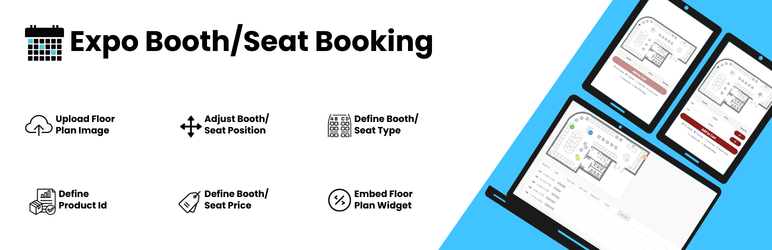

# Booth Booking

Interactive expo booth booking for WordPress with a clickable floor map and WooCommerce integration.

Upload your event floor plan, place clickable booths on it, link each booth to a WooCommerce product, and let exhibitors reserve and buy booths directly from the map.



## Features

- **Interactive floor map**: upload any layout image and place booths with percentage-based (responsive) positions
- **Visual booth editor**: drag and drop booths on the map in WP Admin, or edit the JSON directly
- **WooCommerce integration**: one product per booth, AJAX add-to-cart, stock-based final booking
- **Temporary reservations**: booths are held for about 10 minutes while in a cart, which prevents double booking
- **Admin manual booking**: mark booths as booked for offline, VIP or sponsor allocations
- **Exhibitor details**: Full Name and Email are collected per booth at checkout and saved on the order
- **Elementor widget**, plus a shortcode for any page builder
- **HPOS compatible** (WooCommerce High-Performance Order Storage)

## Requirements

- WordPress 5.8+
- PHP 7.4+
- WooCommerce (required)
- Elementor (optional)

## Installation

**From WordPress.org:** Plugins → Add New → search for "Booth Booking" → Install → Activate.

**From GitHub:**

```bash
cd wp-content/plugins
git clone https://github.com/hasnatahmad095/booth-booking.git
```

Then activate **Booth Booking** under Plugins.

## Usage

1. Create one WooCommerce **Simple** product per booth with stock quantity `1`.
2. Go to **WP Admin → Expo Maps → Add New**.
3. Upload the floor map image.
4. Add booths with the visual editor, or paste JSON:

   ```json
   [
     {"id":"A1","x":12.5,"y":30.2,"type":"cp_outside","type_label":"CP Outside","color":"#00a65a","product_id":123,"price":3500,"admin_booked":false}
   ]
   ```

5. Publish, then display the map with the shortcode or the Elementor widget:

   ```
   [hasnat_bb_booth_map id="123"]
   ```

### Booth fields

| Field          | Required | Description                                          |
| -------------- | -------- | ---------------------------------------------------- |
| `id`           | yes      | Unique booth label shown on the map                  |
| `x`, `y`       | yes      | Position as a percentage of the image width / height |
| `product_id`   | yes      | Linked WooCommerce product ID                        |
| `type`         | no       | Booth category key, used to group the legend         |
| `type_label`   | no       | Human-readable type name shown in the legend         |
| `color`        | no       | HEX color for the booth marker and legend            |
| `price`        | no       | Display price in the tooltip and selection table     |
| `admin_booked` | no       | `true` marks the booth as booked regardless of stock |

## Project structure

```
booth-booking/
├── booth-booking.php          # Main plugin file (header, constants, bootstrap)
├── uninstall.php              # Cleans up plugin post meta on uninstall
├── readme.txt                 # WordPress.org readme
├── includes/
│   ├── class-hasnat-bb-plugin.php            # Loads all components
│   ├── class-hasnat-bb-cpt.php               # "Expo Map" post type and admin meta box
│   ├── class-hasnat-bb-shortcode.php         # Frontend shortcode, booth status
│   ├── class-hasnat-bb-woocommerce.php       # Cart, checkout, order hooks, AJAX
│   └── class-hasnat-bb-elementor-widget.php  # Elementor widget
├── assets/
│   ├── css/  admin.css, frontend.css
│   └── js/   admin.js, frontend.js
└── .wordpress-org/            # Banner, icon and screenshots for the WordPress.org listing
```

All PHP code lives in the `Hasnat\BoothBooking` namespace. Global identifiers (constants, options, meta keys, hooks, CSS classes) use the `hasnat_bb` / `hasnat-bb` prefix.

## Building a release zip

`.gitattributes` excludes development files from archives, so a clean installable zip is:

```bash
git archive --format=zip --prefix=booth-booking/ -o booth-booking.zip HEAD
```

## Contributing

Issues and pull requests are welcome at [github.com/hasnatahmad095/booth-booking](https://github.com/hasnatahmad095/booth-booking/issues).

## License

GPLv2 or later. See [LICENSE](LICENSE).

Author: [Hasnat Ahmad](https://github.com/hasnatahmad095)
